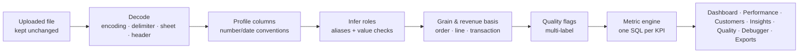

# MIERU 見える — Commerce Intelligence Studio

> **Upload a sales spreadsheet and get trustworthy, explainable analytics automatically, with every number auditable.**

**Live demo:** https://mieru.braveocean-6888a480.centralindia.azurecontainerapps.io (hosted on Azure Container Apps and scaled to zero when idle, so the first visit can take up to a minute to wake it).

MIERU (*mieru*, Japanese for "to be visible") is a full-stack e-commerce analytics product with two workspaces:

| Workspace | What it does |
|---|---|
| **Your data** | Drop a CSV or Excel export. MIERU detects the file's structure, recognises its columns (English, Japanese, Portuguese and Spanish names), resolves revenue without double counting and applies conservative, reversible cleaning. It then builds an executive dashboard, performance analytics (revenue bridge, profitability, returns, discounts, concentration), customer intelligence (RFM, cohorts, repeat purchase), a revenue forecast, evidence-gated insight cards, a **Data Quality Impact Explorer**, a **Metric Debugger** and exports — with no forms and no mapping wizard. |
| **Olist marketplace demo** | Interactive dashboards over **96,470 real delivered orders** from Olist (Brazil's largest department-store marketplace), backed by a preserved, reproducible research study: DuckDB marts, statistical tests and logistic regression. |

Stack: **Python 3.14 · FastAPI · DuckDB · pandas · SciPy · statsmodels · scikit-learn · React 19 · TypeScript · Vite 8 · Plotly · TanStack Query · pytest · Vitest · axe-core**

---

## What works today (verified on localhost)

| Capability | Verified by |
|---|---|
| **Olist demo:** executive overview, delivery & reviews (with an SLA risk simulator), customers & retention (cohorts, RFM), sellers & concentration (Lorenz, tiers), categories & regions (scorecards with Wilson 95% CIs), Decision Center, research findings | API values equal the research pipeline's `metrics_summary.json`; category and state GMV each reconcile to R$15,423,084.73 (tests) |
| **Metric Debugger** for every KPI: formula, executed SQL, source columns, grain, exclusions, record counts, lineage | `input = contributing + Σ excluded` asserted for every metric; KPI value = debugger value |
| **Upload → automatic dashboard** for CSV / TSV / TXT / XLSX: KPIs, trend with fair period comparison, product / category / region / channel breakdowns, filters | hand-computed fixtures |
| Encodings UTF-8 (± BOM), **Shift_JIS / CP932**, Latin-1 / CP1252; delimiters `, ; tab \|`; decimal-comma numbers; ISO, Japanese, day-first, month-first and mixed dates | fixture tests |
| Grain detection (order, line item, transaction); order totals counted **once per order**; returns, discounts, cancellations and duplicates with verified semantics | double-count, returns and discount fixtures |
| **Performance:** revenue bridge (gross sales → discounts → returns → net revenue → cost → gross profit), profitability, returns, discounts, Pareto concentration + Gini | hand-computed fixture; bridge reconciles to the KPIs under every filter |
| **Customer intelligence:** RFM segments, acquisition cohorts with right-censoring, censoring-safe 90-day repeat rate, reconciliation to dashboard revenue | fixture + Olist parity tests |
| **Forecasting:** naive, seasonal naive, moving average, Ridge, Random Forest; rolling-origin backtest on identical points; intervals only when calibrated | no-leakage, identical-backtest and coverage tests |
| **Decision Center:** deterministic insight cards (finding, evidence, interpretation, action, limitations, gates) | evidence-gate tests |
| **Exports:** cleaned / annotated CSV, Excel workbook (data, quality, audit, KPIs, analytics tables), HTML / Markdown report — all filter- and policy-aware, formula-injection safe | export tests |
| **Data Quality Impact Explorer:** issues, before/after KPIs, reversible policies, column profiles, audit trail | tests + browser |
| Session-private uploads, CSRF header, rate limits, bounded processing, TTL expiry and scoped cleanup, hostile-file guards | security tests |
| Light and dark themes, keyboard navigation, screen-reader semantics | Vitest + axe-core checks |
| **Brand intro:** a 4.4-second animated MIERU intro (React + CSS + inline SVG from the approved Figma Make design) over the live dashboard, played once per browser session, with Skip / Esc / click-to-skip and a reduced-motion variant | Vitest + browser checks at desktop and phone widths |

**Real-data check:** uploading Olist's own `order_items.csv` (112,650 rows) through the *generic* upload path, with no Olist-specific logic, gives revenue **13,591,643.70** and **98,666** orders. Both match direct SQL on the warehouse exactly.

**Independent review:** a read-only correctness/security review of the upload stack found 13 issues (e.g. returned items charging their cost twice, a sparse-XLSX memory exhaustion, filtered exports mixing scopes). Twelve were fixed and one was kept as an explicit, documented definition; each fix has a regression test (`tests/product/test_review_regressions.py`).

Not built yet: the Japanese UI toggle. A production container image, GitHub Actions CI and an Azure Container Apps guide are ready ([docs/deployment-azure.md](docs/deployment-azure.md)).

---

## Quick start

```bash
python -m venv .venv
```
```bash
.venv\Scripts\activate
```
(macOS / Linux: `source .venv/bin/activate`)
```bash
pip install -r requirements.txt
```
```bash
python run.py
```
```bash
npm --prefix frontend install --ignore-scripts
```
```bash
npm --prefix frontend run build
```
```bash
python -m mieru
```

Open **http://127.0.0.1:8000**. `run.py` downloads the public Olist CSVs (~125 MB, cached) and builds the DuckDB warehouse in about 10 seconds. `python -m mieru` serves both the API (docs at `/api/docs`) and the built web app.

For frontend development, run `npm --prefix frontend run dev` (Vite on :5173, proxying `/api` to :8000) next to `python -m mieru`.

A synthetic sample file with deliberate data-quality problems can be downloaded from the upload page ("Download a synthetic sample file"). It is generated by `scripts/make_sample_dataset.py`, seed 7. The same data is also offered as a Japanese-header Excel workbook; both files, the expected numbers and a short demo flow are in [`demo/`](demo/README.md).

---

### Run with Docker

```bash
docker build -t mieru .
```
```bash
docker run --rm -p 8000:8000 -e MIERU_SESSION_SECRET=<64 random hex characters> mieru
```

The build downloads the public Olist CSVs, reruns the research pipeline, checks the results against the published baseline, and packs only the tables the app reads into a 31 MB database. The image runs as a non-root user with production settings (secure cookies, 20 MB / 250,000-row uploads, one processing worker); see `.env.example` for every setting.

## How uploads stay trustworthy



1. **No guessing.** Money columns (amount, price, total, cost, discount) are mapped only with name evidence. When two columns could fill the same role, or a column could be a line amount or an order total, MIERU says so in a clarification banner instead of choosing. Metrics that cannot be computed are shown as unavailable with the reason. **Profit is never estimated without a cost column.**
2. **Revenue is counted once.** MIERU detects whether each row is an order, an order line or a transaction. An order total repeated on every line is counted once per order. Line revenue comes from an amount column, or from quantity × unit price, with relational checks.
3. **Signs are only interpreted when verified.** Returns are detected by a return status, a return flag or a negative quantity, and are netted at their net value (a returned discounted item reverses what was actually paid); returned items also reverse their cost. A discount is subtracted only when the data shows the amount is gross. Unexplained negative values are kept as recorded and flagged. Files that mix currencies get no cross-currency totals.
4. **Cleaning never deletes anything.** The source file and an all-text copy stay untouched. Each policy is a reversible query parameter:

   | Policy | Default |
   |---|---|
   | Exclude blank rows | on |
   | Exclude confirmed duplicates (same transaction ID *and* identical content) | on |
   | Exclude possible duplicates (identical rows without an ID, which may be genuine repeat purchases) | **off** (opt-in) |
   | Exclude cancelled orders | on |

5. **The numbers always add up.** Every excluded row gets exactly **one** primary reason, by fixed precedence. Quality flags (outliers, possible duplicates, text normalisation and so on) can overlap and are reported separately. Each KPI and its debugger counts come from the **same compiled DuckDB query**, so `input = contributing + Σ exclusions` holds by construction. The revenue bridge reconciles exactly to net revenue, and customer segments reconcile to dashboard revenue (any difference is explained).
6. **Periods are compared fairly.** Partial first and last periods are greyed out and excluded from period-over-period comparisons; empty periods count as zero; cohort cells that are not yet fully observable are left blank. This is the same right-censoring discipline used in the research study.

Full definitions: [**docs/metric-definitions.md**](docs/metric-definitions.md). System design: [**docs/architecture.md**](docs/architecture.md).

## Security & privacy
- **Private sessions:** uploads are bound to a signed, `HttpOnly`, `SameSite=Strict` session cookie (`Secure` in production); any other session gets a 404. Production refuses to start without a persistent `MIERU_SESSION_SECRET` of at least 32 bytes.
- **Request protections:** mutations require a custom request header (CSRF defence); uploads are limited per IP and per session; processing runs in a bounded pool that returns 429 when full; policy updates are atomic.
- **File limits and checks:** 50 MB, 1M rows and 300 columns, enforced while streaming; extension and magic-byte checks; zip-bomb, macro and sparse-sheet guards for XLSX (cell budget); Excel formulas are never executed.
- **Hardening:** column names never reach SQL and values are bound as parameters; Content-Security-Policy and other security headers; exports neutralise spreadsheet formulas and HTML reports are escaped; no `dangerouslySetInnerHTML`.
- **Expiry:** uploads expire after 2 hours. Cleanup deletes only expired directories under `var/datasets/` that carry MIERU's marker file.

---

## Olist research workspace

The original study is preserved unchanged. Its pipeline is `python run.py`, its frozen outputs live in [`baselines/2026-10-15/`](baselines/2026-10-15/), and a regression test guards them. The full write-up is in [**docs/olist-research.md**](docs/olist-research.md). Headline:

> Missing the promised delivery SLA date multiplies the odds of a severe detractor review (1–2 stars) by 16.3× (adjusted OR, 95% CI: [15.40, 17.25], p < 0.0001), while the top 18.6% of sellers generate 80% of platform GMV.

These are adjusted associations from observational data, supported by a dose-response pattern and a placebo-controlled jump at Day 0; they are not randomised causal effects. Retention is near zero (about 97% of customers buy once), and the censoring-safe retention estimate is not statistically significant.

---

## Architecture

```
FastAPI app (mieru.main:create_app) — one process
 ├─ /api/olist/*            Olist dashboards (read-only DuckDB, marts 01–07)
 ├─ /api/olist/research/*   original research API, mounted unchanged
 ├─ /api/metrics/olist/*    Olist metric registry + Metric Debugger
 ├─ /api/datasets/*         upload → status → dashboard / performance / customers / forecast /
 │                          insights / quality / explain / exports / policies / mapping
 └─ /*                      React single-page app (frontend/dist)
```

| Path | Responsibility |
|---|---|
| `mieru/ingest/` | readers (CSV/TSV/TXT/XLSX), encoding & delimiter detection, file guards |
| `mieru/schema/` | parsing conventions, column profiles, multilingual aliases, role inference |
| `mieru/canonical/` | grain detection, revenue basis, sign/discount/return/cost semantics, quality flags |
| `mieru/metrics/` | metric definitions, upload metric engine (exclusion precedence, invariants) |
| `mieru/analytics/` | dashboard, performance (bridge, profitability, returns, discounts, concentration), customer intelligence |
| `mieru/quality/`, `mieru/insights/`, `mieru/forecast/`, `mieru/reports/` | Quality Explorer, Decision Center rules, forecasting engine, exports |
| `mieru/datasets/`, `mieru/security/` | session-bound store, processing pool, TTL cleanup; cookies, CSRF, limits |
| `mieru/olist/` | Olist warehouse access, metric registry, dashboard services, market scorecards |
| `run.py`, `src/`, `sql/01-03` | preserved research pipeline (`sql/04-07` add dashboard marts) |
| `frontend/src/` | design tokens (light/dark), Plotly wrapper (cartesian bundle), Metric Debugger drawer, brand intro (`intro/`), pages |

## Testing

```bash
python -m pytest -q
```
```bash
npm --prefix frontend test
```

Current status: **118 backend tests** and **113 frontend tests** pass, the typecheck is clean, the build succeeds and Prettier reports no issues.
- **Research:** the original 14 research tests, plus a baseline-regression test.
- **Olist parity:** API values vs the research pipeline, reconciliation of every breakdown and scorecard, Metric Debugger invariants.
- **Upload fixtures:** hand-computed results covering the double-count trap, duplicates, returns and discounts, cost reversal, CP932, EU number formats, multi-sheet XLSX, uncached formulas, ambiguous and mixed dates, ragged rows, multiple currencies and split payments.
- **Analytics:** revenue bridge, profitability, concentration/Gini, customer intelligence, forecasting (leakage, identical backtests, interval coverage), insight gates, exports.
- **Security and failure handling:** hostile files (sparse-sheet bomb, fake XLSX, empty file), oversize uploads, rate limits, CSRF, session isolation, cleanup scope, atomic policy updates.
- **Frontend:** formatters, tables, KPI cards, dataset chrome, waterfall geometry, theme logic and colour remapping, the brand intro (skip paths, failsafe, once-per-session, inert app underneath) and axe-core accessibility checks.
- **Demo kit:** the English CSV and the Japanese Excel workbook produce identical, pinned KPIs.

## Roadmap
| Milestone | Status |
|---|---|
| M0–M5: baseline, backend, Olist dashboards, premium UI, upload pipeline, Quality Explorer, Metric Debugger | ✅ |
| M6: performance analytics (bridge, profitability, discounts, returns, concentration) + Olist category/region scorecards | ✅ |
| M7: RFM, cohorts and repeat purchase (uploads and Olist) | ✅ |
| M8: Decision Center (evidence-backed insight cards) | ✅ |
| M9: forecasting with rolling-origin backtests and calibrated-only intervals | ✅ |
| M10: exports (cleaned CSV, XLSX workbook, HTML/Markdown report) | ✅ |
| M12: dark mode, accessibility, performance (Plotly partial bundle) | ✅ |
| M11: Docker image, GitHub Actions CI, Azure Container Apps guide | ✅ |
| M12: Japanese UI toggle | ⏸ deferred |

## Limitations
- A bare `$` is read as USD, but it may be another dollar currency.
- XLSX formulas are read from the cached values Excel saved; workbooks written by tools that store no cached values show those cells as missing (reported as invalid amounts).
- Uploads live on local disk for 2 hours (60 minutes in the container image). There is no persistent storage, and sessions do not survive a server restart; on the hosted demo the app sleeps when idle, which also clears uploads.
- Returned items are assumed to go back to stock (their cost is reversed); this is stated wherever profit is shown.
- Forecasts are statistical extrapolations of history; intervals are shown only when backtests support them.

## Licence

The MIT License ([LICENSE](LICENSE)) covers the source code written for this project only. The Olist demo uses the [Brazilian E-Commerce Public Dataset by Olist](https://www.kaggle.com/datasets/olistbr/brazilian-ecommerce), licensed [CC BY-NC-SA 4.0](https://creativecommons.org/licenses/by-nc-sa/4.0/). The raw dataset is downloaded by `run.py` and is not stored in this repository. The aggregate research results in `baselines/` and `outputs/`, and the database and figures inside the container image, are derived from it; they are shared under CC BY-NC-SA 4.0, with attribution to Olist and for non-commercial use only, not under the MIT License (see [NOTICE](NOTICE)). MIERU is a non-commercial portfolio project and is not affiliated with Olist.
