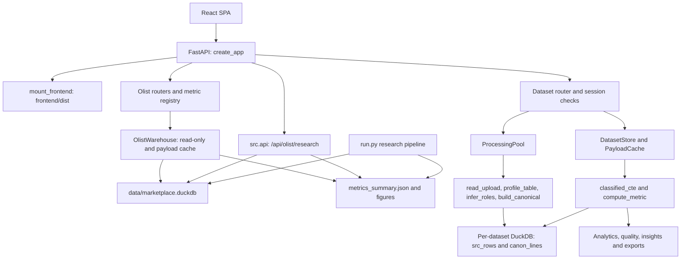
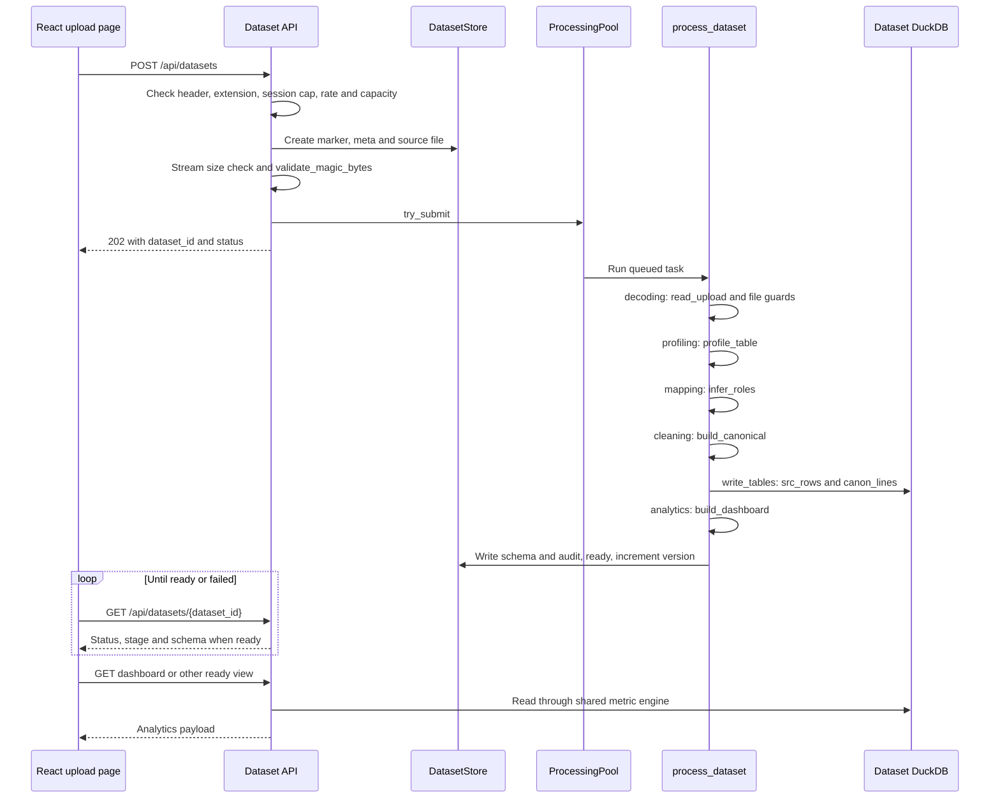

# MIERU (見える): architecture reference

This reference describes the checked-in implementation. Metric semantics and rule thresholds are in [metric-definitions.md](metric-definitions.md). Source links point to the implementation.

## 1. System overview

[`mieru.main.create_app`](../mieru/main.py) constructs one FastAPI application. [`mieru.__main__.main`](../mieru/__main__.py) starts Uvicorn with `"mieru.main:create_app"` and `factory=True`. The application includes API routers, mounts the original research FastAPI application, and serves the built React SPA from `frontend/dist` through [`mount_frontend`](../mieru/web.py). API documentation is at `/api/docs`; OpenAPI is at `/api/openapi.json`.

The two workspaces have separate data paths:

| Workspace | Data and computation | Boundary |
|---|---|---|
| Olist marketplace demo | `data/marketplace.duckdb`, seven research/dashboard marts, `outputs/metrics_summary.json`; `OlistWarehouse` opens DuckDB read-only | Fixed Olist schemas, delivered-order rules, `customer_unique_id` resolution and BRL GMV |
| Your data | One `var/datasets/<dataset_id>/dataset.duckdb` per upload; generic inference and canonicalization | Session ownership, expiry, inferred grain/revenue basis and reversible policies; no Olist table dependency in `process_dataset` |

This separation lets uploads use their own source columns and revenue semantics without changing the Olist marts or research API. See [`process_dataset`](../mieru/datasets/processor.py), [`OlistWarehouse`](../mieru/olist/warehouse.py) and [`src/warehouse.py`](../src/warehouse.py).



## 2. Olist demo path

[`run.run_pipeline`](../run.py) calls `download_raw_files`, `verify_raw_schemas`, `build_warehouse`, `run_analysis` and `render_all_figures`, in that order. [`src.warehouse.build_warehouse`](../src/warehouse.py) loads eight `raw_*` tables, verifies multiline review parsing against an independent CSV record count, executes `MART_SQL_FILES`, checks grain/distance integrity and checkpoints `data/marketplace.duckdb`. [`src.analysis.run_analysis` / `write_metrics`](../src/analysis.py) produce `outputs/metrics_summary.json`.

| SQL file in `MART_SQL_FILES` | Table | Grain / role |
|---|---|---|
| [`01_mart_order_fulfillment.sql`](../sql/01_mart_order_fulfillment.sql) | `mart_order_fulfillment` | One delivered order; complete purchase/delivered/estimated dates; item/review aggregation before joins; customer sequencing and delivery outcomes |
| [`02_mart_cohort_retention.sql`](../sql/02_mart_cohort_retention.sql) | `mart_cohort_retention` | `(cohort_month, period_number)`; true first delivered purchase, observable zero-filled cells, periods 0–11 |
| [`03_mart_seller_pareto.sql`](../sql/03_mart_seller_pareto.sql) | `mart_seller_pareto` | One seller; outcomes first collapsed to seller/order; GMV ranking and cumulative shares |
| [`04_mart_olist_monthly.sql`](../sql/04_mart_olist_monthly.sql) | `mart_olist_monthly` | Purchase month; months before `2017-01-01` and the final month marked `is_partial` |
| [`05_mart_olist_category.sql`](../sql/05_mart_olist_category.sql) | `mart_olist_category` | Category; financial sums at item grain, outcomes at category/order grain |
| [`06_mart_olist_state.sql`](../sql/06_mart_olist_state.sql) | `mart_olist_state` | Customer state; delivered-order aggregation |
| [`07_mart_olist_payments.sql`](../sql/07_mart_olist_payments.sql) | `mart_olist_payments` | Payment type; records belonging to delivered orders |

`OlistWarehouse._connection_for_current_file` checks `REQUIRED_TABLES`, reopens its read-only connection when the database modification time changes and clears its payload cache. `cached_payload` keys entries by `(key, database_mtime)`. `research_metrics_path` prefers the current JSON, falling back to `baselines/2026-10-15/metrics_summary.json`; `figure_path` searches outputs before the baseline directory. Database absence/missing marts becomes HTTP 503 through [`cached_olist_payload`](../mieru/api/dependencies.py).

All routes below are GETs. Sources: [`mieru/api/olist.py`](../mieru/api/olist.py), [`mieru/api/metrics.py`](../mieru/api/metrics.py), [`src/api.py`](../src/api.py).

| Endpoint | Handler / result |
|---|---|
| `/api/olist/overview` | `get_overview` → `build_overview` |
| `/api/olist/delivery` | `get_delivery` → `build_delivery` |
| `/api/olist/customers` | `get_customers` → `build_customers` |
| `/api/olist/sellers` | `get_sellers` → `build_sellers` |
| `/api/olist/markets` | `get_markets` → `build_markets` |
| `/api/olist/research` | `get_research` → `build_research` |
| `/api/olist/insights` | `get_insights` → `build_olist_insights` |
| `/api/olist/customer-intelligence` | `get_customer_intelligence` → `build_olist_customer_intelligence` |
| `/api/olist/forecast` | `get_forecast` → `build_olist_forecast` |
| `/api/olist/figures/{file_name}` | `get_figure`; accepts only names in `RESEARCH_FIGURES` |
| `/api/olist/research/` | Mounted `src.api.get_index` |
| `/api/olist/research/summary` | Original research JSON |
| `/api/olist/research/cohorts` | `start_month` / `end_month`; bound SQL parameters |
| `/api/olist/research/sla-simulator` | Persisted Model 1 coefficients; delay enters only as `delay_days > 0` |
| `/api/olist/research/docs`, `/api/olist/research/redoc`, `/api/olist/research/openapi.json` | Mounted application's default FastAPI documentation/schema routes |
| `/api/metrics/olist` | `OLIST_METRICS` definitions and availability |
| `/api/metrics/olist/{metric_id}/explain` | `explain_olist_metric`: value, SQL, counts, lineage and upstream funnel |

## 3. Upload pipeline

[`upload_dataset`](../mieru/api/datasets.py) returns HTTP 202 after storing and submitting a file. Extension, streamed byte size and magic bytes are checked before submission. Row/column limits and XLSX archive/dimension guards run inside the worker while decoding; they are not all synchronous upload checks.



[`STAGES`](../mieru/datasets/processor.py) is `("uploaded", "decoding", "profiling", "mapping", "cleaning", "analytics", "ready")`. [`DatasetChrome.tsx`](../frontend/src/features/datasets/DatasetChrome.tsx) renders the first six in its processing stepper; `ready` exits that view.

| Stage | User label | Implementation |
|---|---|---|
| `uploaded` | File received | `DatasetStore.create`: UUID hex ID, `.mieru-dataset`, `meta.json`; router saves `source<extension>`, byte size and SHA-256 |
| `decoding` | Reading & decoding | [`read_upload`](../mieru/ingest/readers.py) → `read_delimited` or `read_workbook`; encoding, delimiter, worksheet and header detection; ragged-row tracking |
| `profiling` | Profiling columns | [`profile_table` / `profile_column`](../mieru/schema/profile.py), [`parse_numeric_series` / `parse_date_series`](../mieru/schema/parsing.py): conventions, parse rates, samples, cardinality |
| `mapping` | Detecting column roles | [`infer_roles`](../mieru/schema/infer.py), [`ROLE_ALIASES`](../mieru/schema/aliases.py), optional stored mapping overrides |
| `cleaning` | Cleaning & checking quality | [`build_canonical`](../mieru/canonical/build.py), then `write_tables`; flags and typed values, source rows retained |
| `analytics` | Building dashboards | `dataset_context_from_schema`, read-only `open_dataset_connection`, `build_dashboard` as generation check; write `schema.json` and `audit.json` |
| `ready` | Ready status | `process_dataset` sets `status="ready"`, `stage="ready"`, clears error, increments `data_version`, invalidates cached payloads |

`UploadRejectedError` records its message as `status="failed", stage="failed"`; unexpected exceptions are logged and produce the generic processing error. `ready_schema` returns 409 until ready. The frontend's [`useDatasetStatus`](../frontend/src/features/datasets/queries.ts) polls every 600 ms until `ready` or `failed`.

`infer_roles` uses `ASSIGNMENT_THRESHOLD = 0.6`, `FINANCIAL_NAME_EVIDENCE = 0.7`, `PARTIAL_NUMERIC_RATE = 0.5` and `AMBIGUITY_MARGIN = 0.05`. Two eligible candidates whose confidence difference is **less than** `0.05` block that role and create a clarification. Parsing supports the explicit formats in `parsing.py`; tied day-first/month-first evidence leaves those ambiguous formats uninterpreted. Raw dataframe columns are generated as `c000`, `c001`, …; uploaded column names remain metadata rather than SQL identifiers (`process_dataset`, `write_tables`).

## 4. Canonical model

[`CANONICAL_COLUMNS`](../mieru/canonical/build.py) contains the following columns, grouped here by meaning. `canon_lines` retains one row per parsed source row, including excluded rows. [`write_tables`](../mieru/datasets/processor.py) stores `_row_id` as `BIGINT`, `order_ts` as `TIMESTAMP`, text as `VARCHAR`, numeric measures as `DOUBLE`, and flags as `BOOLEAN`. `src_rows` stores `_row_id` plus parsed table cells as `VARCHAR`; the reader truncates extra ragged fields and pads missing ones, while the original uploaded file remains unchanged.

| Group | Exact column names |
|---|---|
| Identifiers | `_row_id`, `order_id`, `line_id`, `customer_id`, `product_id`, `product_name`, `product_key` |
| Time and dimensions | `order_ts`, `category`, `status_raw`, `status_norm`, `channel`, `region`, `country`, `city`, `currency`, `payment_method` |
| Parsed and derived values | `quantity`, `unit_price`, `line_amount`, `order_total`, `discount_value`, `tax`, `shipping`, `cost_value`, `refund_amount`, `line_value`, `signed_value`, `net_value` |
| Flags | `is_return`, `is_blank`, `is_ragged`, `dup_reliable`, `dup_possible`, `key_conflict`, `is_cancelled`, `value_invalid`, `order_total_conflict`, `date_invalid`, `quantity_invalid`, `negative_unverified`, `is_outlier`, `text_normalized` |

`product_key` prefers `product_name`, falling back to `product_id`. `build_canonical` requires `ORDER_ID_COVERAGE = 0.9` over nonblank rows to use order-based grain. Ignoring exact duplicate/blank rows for this decision, repeated order IDs imply `line`; otherwise `order`; insufficient order-ID coverage gives `transaction`.

Revenue priority is `line_amount` → `quantity_x_unit_price` → `order_total` → `unit_price_one_unit_per_row` → unavailable. Generic `amount` may become `order_total` when constancy/product/name/evidence checks support it; explicit line naming and user overrides prevent that promotion. Order totals are selected once by the metric CTE, without allocating them across products. The detailed tests and thresholds are in [Revenue semantics](metric-definitions.md#2-revenue-semantics).

## 5. Shared metric engine

[`classified_cte`](../mieru/metrics/upload.py) applies `Filters.where` before classification, then assigns one `exclusion_reason` per row with a SQL `CASE`. Precedence is:

1. Policy-controlled `blank_row`, `duplicate_reliable`, `duplicate_possible`, `cancelled`.
2. Scope-controlled `order_total_conflict` (only order-total revenue), `invalid_amount`, `invalid_date`, `invalid_quantity`, `missing_customer`, `missing_order`, `missing_cost`, in that order when their scopes apply.

The CTEs are `classified`, `ranked`, `scoped`. `contributes` means `exclusion_reason IS NULL`. `order_line_rank` partitions by `order_id` and contribution status, ordered by `_row_id`; `order_value_once` selects the first contributing order total, or the row's total when `order_id IS NULL`. Therefore selection is within the filtered, classified query scope.

`compute_metric` obtains the KPI value, input/contributing counts, reason counts and contributing-row flag counts from one SQL statement. Thus `input_records = contributing_records + Σ excluded.records`; [`RecordCounts.is_consistent`](../mieru/metrics/definitions.py) exposes the check. A separate query obtains whole-file row count for context. Flags can overlap and do not enter this identity. Availability is checked before SQL; unavailable metrics have no record-count object.

`POLICY_DEFAULTS` sets `exclude_blank_rows=True`, `exclude_reliable_duplicates=True`, `exclude_possible_duplicates=False`, `exclude_cancelled=True`. These become bound boolean parameters: a policy update changes metadata and queries, not stored rows. Mapping updates queue `process_dataset` again.

`Filters` supports inclusive `start`/`end` dates and category/region/channel lists using bound parameters. `parse_filters` validates ISO dates and date ordering, and sorts/deduplicates each list to at most 50 values. Geography selects the first mapped column in `region`, `country`, `city` (`analytics.dashboard.region_column`).

| Consumer | Shared computation |
|---|---|
| [`analytics/dashboard.py`](../mieru/analytics/dashboard.py) | `compute_metric` for `DASHBOARD_KPIS`; `classified_cte` for trends and breakdowns, with metric-specific scopes |
| [`analytics/performance.py`](../mieru/analytics/performance.py) | `scoped_query` wraps `classified_cte` for bridges, profitability, returns, discounts and concentration |
| [`analytics/customers.py`](../mieru/analytics/customers.py) | `upload_customer_orders` uses revenue/date/customer/order scopes; dashboard reconciliation calls `compute_metric` |
| [`quality/explorer.py`](../mieru/quality/explorer.py) | `compute_metric` compares active policies, all policies off, and individual toggles; issue counts are whole-file flags |
| [`insights/upload.py`](../mieru/insights/upload.py) | `frame` wraps `classified_cte`; individual rules call `compute_metric` and `build_trend` |
| [`reports/exports.py`](../mieru/reports/exports.py) and dataset export handler | `row_query` uses the classifier and joins `src_rows`; reports/workbooks call dashboard, quality, insights and performance builders with active filters |
| Metric Debugger | `GET /api/datasets/{dataset_id}/metrics/{metric_id}/explain` calls `compute_metric`, returning SQL rendered with parameter values, source-role mapping and assumptions |

These consumers share classification, but intentionally use different scopes. For example, revenue totals need not have a date/customer ID, while customer intelligence does. Product/category order counts are not additive across groups (`build_breakdown`).

## 6. Security and isolation

Sources: [`config.py`](../mieru/config.py), [`security/session.py`](../mieru/security/session.py), [`security/limits.py`](../mieru/security/limits.py), [`datasets/store.py`](../mieru/datasets/store.py), [`datasets/processor.py`](../mieru/datasets/processor.py), [`ingest/readers.py`](../mieru/ingest/readers.py), [`api/datasets.py`](../mieru/api/datasets.py), [`web.py`](../mieru/web.py), [`reports/exports.py`](../mieru/reports/exports.py).

| Control | Implemented behavior / default |
|---|---|
| Session cookie | `mieru_session`: token plus HMAC-SHA256 signature; `HttpOnly`, `SameSite="strict"`, path `/`; `SESSION_COOKIE_MAX_AGE_SECONDS = 24 * 60 * 60`; `secure_cookies` is true for `production` |
| Signing secret | `MIN_SESSION_SECRET_BYTES = 32`; configured shorter secrets are rejected; `production` requires `MIERU_SESSION_SECRET`; development persists `dev_session_secret`; test mode generates a secret |
| Ownership | `owner_fingerprint` is SHA-256 of token; constant-time comparison in `get_owned`; absent, foreign or expired datasets become 404 through `owned_meta` |
| CSRF header | Mutations require `X-MIERU-Request: 1` through `require_mutation_header`; missing/wrong value returns 403 |
| Upload rate / dataset cap | `SlidingWindowLimiter`: default 30 uploads per client address per `UPLOAD_WINDOW_SECONDS = 3600`; at most 5 active datasets per session; rejection is 429 |
| Bounded work | `ProcessingPool`: `ThreadPoolExecutor`, default 2 workers plus queue limit 4; capacity `workers + queue_limit`; locked pending counter; full submission returns 429 |
| Request/file bytes | `max_upload_bytes = 50 * 1024 * 1024` by default; ASGI body limit adds `MULTIPART_OVERHEAD_BYTES = 1024 * 1024`; router reads `UPLOAD_CHUNK_BYTES = 1 << 20` and enforces the file limit |
| Table size | Defaults: `max_upload_rows = 1_000_000`, `max_upload_columns = 300`; delimited reader also rejects rows wider than `MAX_FIELDS_PER_ROW_FACTOR = 4` times the column limit |
| Format | Only `.csv`, `.tsv`, `.txt`, `.xlsx`; `validate_magic_bytes` checks XLSX ZIP signature, rejects ZIP/OLE disguised as text and binary NULs except BOM-marked UTF-16 |
| XLSX guards | `XLSX_MAX_UNCOMPRESSED_BYTES = 600 * 1024 * 1024`, `XLSX_MAX_MEMBERS = 2000`, `XLSX_MAX_COMPRESSION_RATIO = 150.0`, `XLSX_MAX_CELLS = 20_000_000`; macro member `vbaproject.bin` rejected; declared sheet dimensions and aggregate cell budget checked |
| Formula reading | `load_workbook(..., read_only=True, data_only=True)` uses saved cell values; formulas are not evaluated |
| Query resources | Dataset connections default to `duckdb_memory_limit="1GB"`, `duckdb_threads=2`, temp directory under `var/tmp/duckdb` |
| Expiry | `dataset_ttl_seconds = 120 * 60` from creation; cleanup at application startup and every 600 seconds by default |
| Cleanup scope | `DATASET_ID_PATTERN = r"^[0-9a-f]{32}$"`; resolved directory must be directly under the dataset root and bear `.mieru-dataset`; cleanup skips symlinks and unmarked directories. Missing metadata requires marker age at least twice the TTL |
| Export cells | `neutralize_formula` prefixes an apostrophe for strings beginning with `FORMULA_PREFIXES = ("=", "+", "-", "@", "\t", "\r")`, except strings matching `PLAIN_NUMBER`; applied to CSV/XLSX headers and values; HTML reports use `html.escape(..., quote=True)` |

`install_security_headers` supplies `X-Content-Type-Options: nosniff`, `Referrer-Policy: same-origin`, `X-Frame-Options: DENY`, `Cross-Origin-Opener-Policy: same-origin`, and `Permissions-Policy: camera=(), microphone=(), geolocation=(), payment=()`. API responses default to `Cache-Control: no-store`. Non-API responses receive `CONTENT_SECURITY_POLICY`:

```text
default-src 'self'; script-src 'self'; style-src 'self' 'unsafe-inline'; img-src 'self' data: blob:; font-src 'self' data:; connect-src 'self'; worker-src 'self' blob:; frame-ancestors 'none'; base-uri 'self'; form-action 'self'; object-src 'none'
```

When `enable_hsts` is true, HSTS is `max-age=31536000; includeSubDomains`. `resolve_static_file` restricts resolved static paths to the frontend directory. Unknown `/api` paths return 404 instead of SPA HTML.

## 7. Caching and invalidation

[`DatasetStore.cache`](../mieru/datasets/store.py) is a locked, least-recently-used `PayloadCache`, with `PAYLOAD_CACHE_SIZE = 256`. [`api/datasets.py`](../mieru/api/datasets.py) builds these keys:

| View | Key tuple |
|---|---|
| Dashboard / performance | `(dataset_id, data_version, "dashboard" or "performance", filters.cache_key(), policies_key(policies))` |
| Quality / insights / customers / forecast | `(dataset_id, data_version, view, policies_key(policies))` |

`Filters.cache_key` uses the first 16 hex characters of SHA-1 over sorted JSON; `policies_key` uses the first 12 over defaults merged with active policies. These four unfiltered view endpoints do not accept dashboard filters. Metric explanations and exports do not use this payload cache.

`DatasetStore.create` initializes `data_version=1`. Each successful `process_dataset` increments it, including successful remapping; `update_policies` increments it inside locked `mutate_meta`. Both invalidate all cache keys beginning with the dataset ID. Mapping submission invalidates immediately; rejection restores prior overrides and ready status. `safe_remove` also invalidates. Olist uses its separate `(view_key, database_mtime)` cache; the JSON output's modification time is not part of that key.

## 8. Frontend architecture

[`main.tsx`](../frontend/src/main.tsx) composes `QueryClientProvider`, `BrowserRouter` and `MetricDebuggerProvider`. Query defaults are `refetchOnWindowFocus: false`, `retry: 1`. [`App.tsx`](../frontend/src/App.tsx) lazy-loads pages under `AppShell` with `Suspense` / `PageSkeleton`; `/` and `/olist` redirect to `/olist/overview`.

| Route | File under `frontend/src/pages/` |
|---|---|
| `/olist/overview` | `olist/OverviewPage.tsx` |
| `/olist/delivery` | `olist/DeliveryPage.tsx` |
| `/olist/customers` | `olist/CustomersPage.tsx` |
| `/olist/sellers` | `olist/SellersPage.tsx` |
| `/olist/markets` | `olist/MarketsPage.tsx` |
| `/olist/insights` | `olist/InsightsPage.tsx` |
| `/olist/research` | `olist/ResearchPage.tsx` |
| `/data` | `data/UploadPage.tsx` |
| `/data/:datasetId` | `data/DatasetDashboardPage.tsx` |
| `/data/:datasetId/performance` | `data/DatasetPerformancePage.tsx` |
| `/data/:datasetId/quality` | `data/DataQualityPage.tsx` |
| `/data/:datasetId/insights` | `data/DatasetInsightsPage.tsx` |
| `/data/:datasetId/customers` | `data/DatasetCustomersPage.tsx` |

[`features/olist/queries.ts`](../frontend/src/features/olist/queries.ts) uses `STATIC_DATA = { staleTime: Infinity, gcTime: Infinity, retry: 1 }`. [`features/datasets/queries.ts`](../frontend/src/features/datasets/queries.ts) keys dashboard/performance requests by dataset ID, version and serialized filters; it uses `keepPreviousData` and `staleTime: 60_000`. Policy/mapping success invalidates dataset queries and `metric-explain` queries. [`useDatasets.ts`](../frontend/src/features/datasets/useDatasets.ts) caches the list for 5 seconds. [`api/client.ts`](../frontend/src/api/client.ts) sends same-origin credentials, mutation headers and upload progress through `XMLHttpRequest`; [`api/types.ts`](../frontend/src/api/types.ts) and [`api/datasetTypes.ts`](../frontend/src/api/datasetTypes.ts) define payload types.

[`charts/Plot.tsx`](../frontend/src/charts/Plot.tsx) shares a lazy import promise for `plotly.js-cartesian-dist-min`, calls `plotly.react`, resizes with `ResizeObserver`, and purges on cleanup. React controls an outer wrapper; Plotly owns the inner DOM node. [`charts/theme.ts`](../frontend/src/charts/theme.ts) supplies `baseLayout`, `baseConfig` and `chartColors`, including reduced-motion transitions. [`charts/waterfall.ts`](../frontend/src/charts/waterfall.ts) translates bridge steps into floating bars.

[`styles/tokens.css`](../frontend/src/styles/tokens.css) defines CSS variables for fonts, spacing, colors, radii, shadows and motion: `--accent: #2a78d6`, `--breach: #eb6834`, durations `150ms`, `220ms`, `300ms`. [`styles/global.css`](../frontend/src/styles/global.css) contains shared styling. Reusable UI includes `Card`, `KpiCard`, `DataTable`, `PageHeader`, `QueryBoundary`, `Skeleton` and state components.

[`intro/MieruIntro.tsx`](../frontend/src/intro/MieruIntro.tsx) is the approved Figma Make brand intro (React + CSS keyframes + inline SVG; timeline in [`intro/timeline.ts`](../frontend/src/intro/timeline.ts): 4,400 ms, failsafe 5,000 ms). `MieruSplash` is rendered in `main.tsx` as a sibling before the providers, so route changes never replay it; it plays once per browser session (`sessionStorage` key `mieru:intro-seen`). [`public/theme-init.js`](../frontend/public/theme-init.js) sets `data-intro` on `<html>` before first paint so the page starts navy instead of flashing light; `MieruSplash` removes it in a layout effect in the same commit as the overlay's first paint. While the overlay shows, the app underneath is `inert`; Skip, Esc or a click fade it out from its current opacity, and it unmounts on `animationend`. Under `prefers-reduced-motion` the static lockup is held for 0.9 s and faded over 0.5 s (its rules are `!important` so the global reduced-motion rule cannot collapse them). Fonts fall back to the system stack because the CSP allows no external fonts.

[`MetricDebugger.tsx`](../frontend/src/components/MetricDebugger.tsx) exposes `useMetricDebugger().open` for Olist or dataset metric references. Its drawer queries `['metric-explain', path]`, preserving dataset filter query strings, and shows value, formula, grain, counts/invariant, overlapping flags, source columns, transformations, exclusions, assumptions, limitations, lineage and SQL. It focuses the close button and closes on Escape. Shared [`CustomerIntelligence`](../frontend/src/components/CustomerIntelligence.tsx) and [`ForecastCard`](../frontend/src/components/ForecastCard.tsx) use endpoint-based query keys and `staleTime: 120_000`; the dataset customer page includes `data_version` in its endpoint URL.

## 9. Testing strategy

Counts are the cases pytest and Vitest collect (parametrised tests count once per parameter). Fixtures and helpers are not counted as tests.

| Python file | `test_*` functions | Collected cases | Assertions covered |
|---|---:|---:|---|
| [`tests/test_pipeline.py`](../tests/test_pipeline.py) | 9 | 14 | Delivered-order grain; Welch review difference; plausible seller Gini; four figures; three legacy endpoint smoke cases; simulator sign dependence; cohort validation/M0; multiline review parsing |
| [`tests/test_baseline_regression.py`](../tests/test_baseline_regression.py) | 2 | 2 | Research baseline comparison (`rel_tol=1e-9`, `abs_tol=1e-12`, named volatile paths ignored); snapshot files exist. Comparison skips when current metrics are absent |
| [`tests/product/test_olist_api.py`](../tests/product/test_olist_api.py) | 14 | 31 | Research/API parity; GMV reconciliation; all 16 `OLIST_METRICS` explanations; three mounted legacy routes; figure whitelist; headers/SPA; secret validation; insight evidence; forecasts; customer and market totals/intervals |
| [`tests/product/test_upload_pipeline.py`](../tests/product/test_upload_pipeline.py) | 33 | 38 | Hand-calculated revenue/grain/return/policy fixtures; encodings/formats; six invalid-file cases; size/CSRF/ownership/expiry; metric invariants; remapping; insights; export safety/filtering; forecasts/customers; bridge, cost reversal, profitability, concentration and report tables |
| [`tests/product/test_upload_edge_cases.py`](../tests/product/test_upload_edge_cases.py) | 10 | 10 | Row-order invariance; doubled identified lines; possible duplicates kept; split payments; mixed dates; uncached formulas; missing dates; ragged rows; IP rate limit |
| [`tests/product/test_review_regressions.py`](../tests/product/test_review_regressions.py) | 14 | 14 | Sparse XLSX pre-iteration rejection; order-total returns; line-total/ambiguous-amount handling; discounted returns; money vs Excel serials; mixed-currency insight gate; missing-order trend revenue; filtered report impact; mapping rollback; concurrent policy updates; later-day repeat; final-month censoring; empty complete week |
| [`tests/product/test_forecast.py`](../tests/product/test_forecast.py) | 7 | 7 | Minimum history; partial periods; no future feature leakage; equal evaluation counts; seasonal skill; scarce-residual interval suppression; simulated interval coverage between 0.65 and 0.97 |
| **Total** | **89** | **116** | pytest collects 116 cases |

[`tests/product/conftest.py`](../tests/product/conftest.py) constructs isolated test settings under `.cache/test-var/<uuid>` and factory-created apps. [`upload_helpers.py`](../tests/product/upload_helpers.py) uploads with the mutation header and polls for ready/failed. The research fixture can invoke `run_pipeline` when artifacts are absent; it was not invoked for this documentation work.

| Frontend file (under `frontend/src/`) | Test declarations | Collected cases | Assertions covered |
|---|---:|---:|---|
| [`lib/format.test.ts`](../frontend/src/lib/format.test.ts) | 9 | 21 | Currency/percent/unit formatting; 11 unit cases; three unavailable values; p-value display |
| [`components/DataTable.test.tsx`](../frontend/src/components/DataTable.test.tsx) | 6 | 7 | Rendering/accessibility, numeric/string sorting, stable ties/null ordering, two empty states, input immutability |
| [`components/KpiCard.test.tsx`](../frontend/src/components/KpiCard.test.tsx) | 4 | 4 | Value/title display, optional calculation action, unavailable reason, debugger opening |
| [`features/datasets/DatasetChrome.test.tsx`](../frontend/src/features/datasets/DatasetChrome.test.tsx) | 7 | 8 | Processing stages, clarification titles/dismissal, schema badges, two active-tab cases |
| [`features/datasets/queries.test.ts`](../frontend/src/features/datasets/queries.test.ts) | 4 | 6 | Empty filters, three date-bound combinations, repeated values, URL encoding |
| [`charts/waterfall.test.ts`](../frontend/src/charts/waterfall.test.ts) | 3 | 3 | Total anchors, floating deductions, zero/loss resets, no input mutation, empty bridge |
| **Total** | **33** | **49** | Vitest collects 49 cases |
