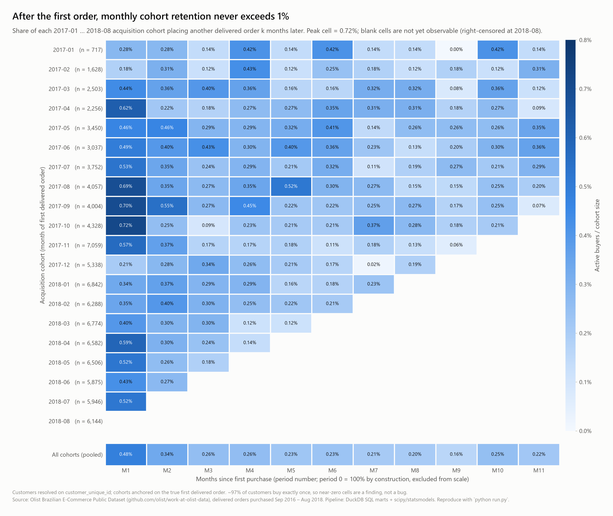
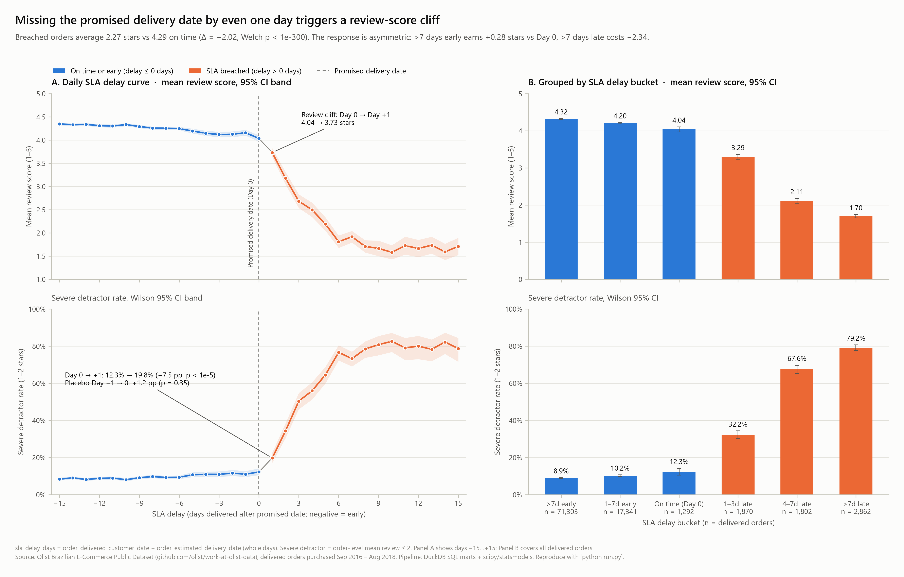
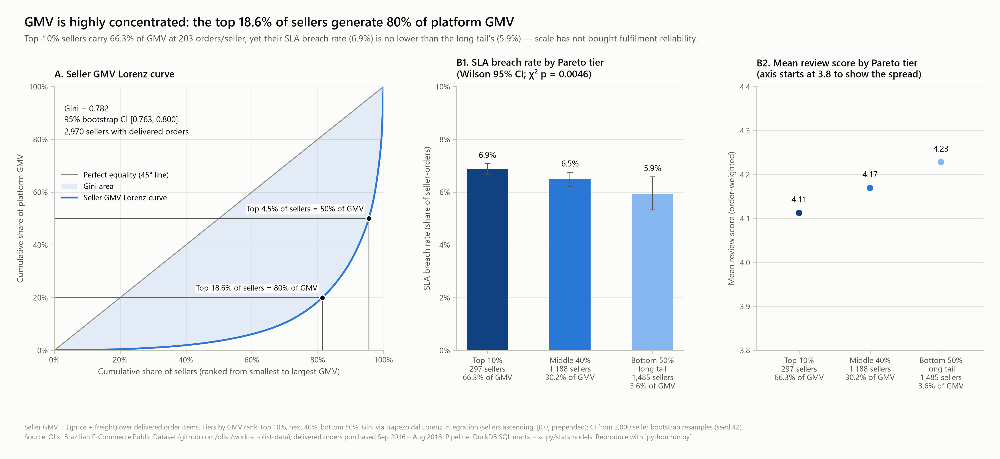
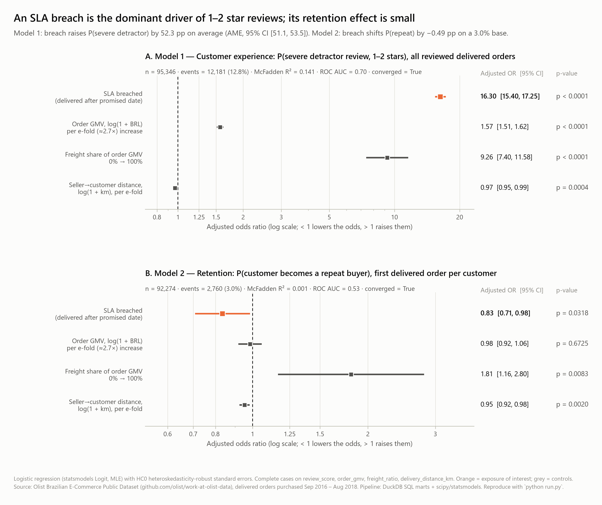
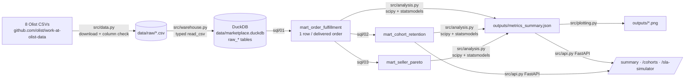

> **Preserved research write-up.** This is the original Olist study README (2026-10-15), kept verbatim apart from figure paths, which now point to the committed baseline snapshot. The study runs inside MIERU as the *Olist marketplace demo* workspace.

# Olist Marketplace: Delivery-SLA Breaches, Cohort Retention & Seller Unit Economics

> **Missing the promised delivery SLA date multiplies the odds of a severe detractor review (1–2 stars) by 16.3× (adjusted OR, 95% CI: [15.40, 17.25], p < 0.0001), while the top 18.6% of sellers generate 80% of platform GMV.**

An end-to-end product & marketplace analytics project on **96,470 real delivered orders** from Olist, Brazil's largest
department-store marketplace (Sep 2016 – Aug 2018). Raw CSVs are loaded into a **DuckDB** analytical warehouse, modelled into
three grain-safe SQL marts, analysed with **scipy / statsmodels** econometrics, visualised in four publication-grade
figures, and served through a **FastAPI** service, all reproducible with one command: `python run.py`.

Stack: DuckDB 1.5 · pandas 3.0 · NumPy 2.5 · SciPy 1.18 · statsmodels 0.15 · matplotlib 3.11 · FastAPI 0.143 · pytest 9 · Python 3.14

---

## 1. Key results at a glance

| Question | Answer (from `outputs/metrics_summary.json`) |
|---|---|
| How often is the delivery promise broken? | **6.77%** of delivered orders arrive after `order_estimated_delivery_date`. The median order arrives **12 days early** (10 days actual vs 24 days promised). |
| What does a breach do to reviews? | Mean review drops from **4.29 → 2.27 stars** (Δ = −2.02, 95% CI [−2.06, −1.98], Welch t = −100.7, p < 1e-300, Cohen's d = −1.71). |
| …and to 1–2 star "severe detractors"? | **9.23% → 62.36%**: +53.1 pp (95% CI [51.9, 54.3]), relative risk **6.75×** [6.57, 6.95], χ² = 15,087. |
| Adjusted for basket value, freight share and distance? | Adjusted **OR = 16.30** [15.40, 17.25]; average marginal effect **+52.3 pp** [51.1, 53.5]. Adding customer-state and purchase-month fixed effects barely moves it (**OR = 15.91** [15.00, 16.88]). |
| How much of the 1–2 star problem do breaches explain? | Breached orders are 6.6% of reviewed orders but generate an estimated **~3,350 excess severe-detractor reviews = 27.5% of all 1–2 star reviews**. |
| Is there a "cliff" at the promised date? | Yes. Day 0 → Day +1 severe-detractor rate **12.3% → 19.8%** (+7.5 pp, p = 4.2e-6). The placebo step Day −1 → Day 0 is only +1.2 pp (p = 0.35). The jump at the threshold is **6.1×** the placebo step. |
| Does a breach kill repeat purchase? | **Only a little, and not robustly.** First-order breach is associated with a repeat-buyer OR of **0.83** [0.71, 0.98], p = 0.032 (≈ −0.49 pp on a 3.0% base), but that estimate is partly a follow-up-time artifact. In the censoring-safe 180-day specification it is **0.75** [0.54, 1.06], p = 0.10, which is not significant. |
| How concentrated is seller GMV? | **Gini = 0.782** (bootstrap 95% CI [0.763, 0.800]). **4.5%** of sellers (133) generate 50% of GMV and **18.6%** (551 of 2,970) generate 80%. |
| Are big sellers more reliable? | **No.** Top-10% sellers breach SLA on **6.9%** of orders vs **5.9%** for the bottom-50% long tail (χ² p = 0.0046), and have a lower mean review (4.11 vs 4.23). |
| What does cohort retention look like? | Near-zero after the first order: pooled month-1 retention is **0.48%**, the best single cohort-month cell is **0.72%**, and the mean cell across months 1–11 is **0.28%**. |

### Data-reality note: this marketplace is overwhelmingly single-purchase
**97.0%** of customers (resolved on `customer_unique_id`) place exactly one delivered order, so the platform repeat-purchase
rate is **3.00%** (2,801 of 93,350 customers). As a result:

1. **Cohort retention is near-zero in every period after period 0.** This is a genuine property of the business (high-consideration,
   low-frequency categories with no loyalty program in the data), not a pipeline bug. Period 0 holds 98.3% of all cohort GMV.
2. **The repeat-purchase model has very little signal** (McFadden R² = 0.001, ROC AUC = 0.53). The SLA effect on retention is
   small and fragile. I report it honestly and do **not** claim a large repeat-purchase effect.
3. **The robust headline is the customer-experience result**: SLA breach → lower review score → severe detractors.

Of the 2,801 repeat customers, **786 (28%) placed all their orders on the same day** (basket splits). That is why a
timing-clean "repeat *after* the first delivery" outcome is used as a sensitivity check.

---

## 2. Figures

All four figures are rendered at 300 DPI by `src/plotting.py` into `outputs/` (regenerate with `python run.py`).

### Figure 1: Monthly cohort retention heatmap

Acquisition cohorts 2017-01 … 2018-08 (with *n*), months since first purchase M1–M11. Period 0 (100% by construction) is excluded
from the colour scale so the 0–0.72% variation is visible. Blank cells are right-censored, and a pooled row summarises all cohorts.

### Figure 2: The SLA breach penalty curve

Panel A: mean review score (95% t-CI band) and severe-detractor rate (Wilson 95% CI band) for each integer `sla_delay_days`
from −15 to +15, with the review cliff just after Day 0. Panel B: the same two metrics across the six SLA delay buckets, with
sample sizes. The response is **asymmetric**: being more than 7 days early earns only +0.28 stars over Day 0, while being more
than 7 days late costs −2.34.

### Figure 3: Seller GMV Pareto / Lorenz curve

Panel A: Lorenz curve vs the line of equality, with the shaded Gini area and crosshairs at the 50% and 80% GMV points. Panel B:
SLA breach rate and order-weighted mean review score by Pareto tier.

### Figure 4: Adjusted odds-ratio forest plot

Adjusted ORs with 95% HC0-robust CIs for Model 1 (severe detractor) and Model 2 (repeat buyer), on a log scale with a reference
line at OR = 1.

---

## 3. Business interpretation (what I would tell the marketplace team)

1. **The delivery promise is the product.** Reviews are almost flat for early deliveries (4.32 → 4.04 stars from more than 7 days early down to Day 0)
   and fall off a cliff once the promise is missed (3.29 at 1–3 days late, 1.70 at more than 7 days late). Customers grade against the
   *promise*, not against absolute speed. Shortening the estimate to look faster in search would turn today's early
   deliveries into breaches. Optimise P(on time), for example by setting the estimate at a high quantile of predicted
   route-level lead time.
2. **Breach prevention is the biggest single lever on public ratings.** If the association is causal, eliminating breaches
   would remove ~3,350 severe-detractor reviews (27.5% of all 1–2 star reviews). Predicted-breach alerts, proactive delay
   messaging and service-recovery vouchers should be triggered *before* Day 0.
3. **Fulfilment reliability has not scaled with seller size.** The 297 top-10% sellers handle 61.5% of seller-orders and
   66.3% of GMV, yet breach at 6.9% vs 5.9% in the long tail. A seller-level SLA program aimed at roughly 300 accounts covers two-thirds
   of GMV. Seller breach rate and seller rating are strongly linked (Spearman ρ = −0.47 across 804 sellers with ≥ 20 orders).
4. **Retention is a separate problem.** With a 3% repeat rate, fixing logistics will lift ratings but will not by itself
   create repeat buyers. Retention needs CRM, category expansion or loyalty mechanics. The measured retention cost of a breach is
   ≈ −0.5 pp, and it is not statistically significant once follow-up time is held fixed at 180 days.

---

## 4. Architecture



### Grain rules (the traps that silently corrupt Olist analyses)
| Trap | What goes wrong | Fix in `sql/01_mart_order_fulfillment.sql` |
|---|---|---|
| **A. Geolocation fan-out** | `raw_geolocation` has 1,000,163 rows for 19,015 zip prefixes (≈ 53 per prefix on average), so a direct join multiplies order rows many times over. | `dedup_geo` CTE: one centroid per prefix (`AVG(lat)`, `AVG(lng)`), after dropping 40 points outside Brazil's bounding box. |
| **B. Order-item fan-out** | 112,650 item rows for 98,666 orders | Pre-aggregate to `order_id`: `item_count`, `items_price`, `freight_value`, `order_gmv`, `freight_ratio`, `primary_seller_id = ARG_MAX(seller_id, price)` |
| **C. Review fan-out** | 547 orders have more than one review | Pre-aggregate to `order_id`: `review_score = AVG(review_score)` |
| **D. Customer identity** | `customer_id` is issued per order (99,441 ids for 96,096 people) | Window over `customer_unique_id`: `customer_order_seq`, `customer_total_orders`, `is_repeat_buyer` |
| **E. Zip-prefix typing** (found during the build) | Geolocation stores `"01037"` while customers and sellers store `1037`, so a string join silently drops São Paulo-area zips | All zip prefixes are cast to `INTEGER` at load time |

Result: `mart_order_fulfillment` has **96,470 rows and 0 duplicate `order_id`s**, exactly the number of eligible delivered orders
in `raw_orders`, with 99.5% distance coverage and 99.3% review coverage.

### SLA definitions
- `sla_delay_days = DATE_DIFF('day', estimated_delivery_date, delivered_customer_date)`: negative = early, 0 = on the promised day, > 0 = breach.
- `is_sla_breached = sla_delay_days > 0`. `is_severe_detractor = review_score ≤ 2` (NULL when the order has no review).
- Six ordered buckets: `>7d Early`, `1-7d Early`, `On Time (Day 0)`, `1-3d Late`, `4-7d Late`, `>7d Late`.
- `delivery_distance_km`: Haversine great-circle distance between the customer and primary-seller zip centroids (R = 6371 km),
  computed as `R·ACOS(clamp(1 − 2·a, −1, 1))` with `a = sin²(Δφ/2) + cosφ₁cosφ₂sin²(Δλ/2)`.

---

## 5. Statistical & econometric methods

| Analysis | Method |
|---|---|
| Review score, on time vs breached | Welch's t-test (`ttest_ind(equal_var=False)`) with a Welch–Satterthwaite 95% CI, Mann–Whitney U (common-language effect size 0.18), Cohen's d |
| Severe-detractor rate | 2×2 χ² (Yates), absolute pp difference with Wald CI, relative risk with log-RR CI, Wilson CIs per group |
| Threshold discontinuity | Day 0 vs Day +1 two-proportion χ², with the Day −1 vs Day 0 step as a placebo |
| Repeat purchase by bucket | Wilson 95% CIs on first orders (`customer_order_seq = 1`), plus a 6×2 χ² test of independence |
| **Model 1** (customer experience) | `Logit(is_severe_detractor ~ is_sla_breached + log1p(order_gmv) + freight_ratio + log1p(distance_km))`, HC0 robust SEs |
| **Model 2** (retention) | Same predictors, outcome `is_repeat_buyer`, first orders only, HC0 |
| Model 2b / 2c (sensitivity) | 2b: exposure = first-order severe detractor. 2c: outcome = new order within 180 days *after* the first delivery, restricted to first orders with a full 180-day follow-up window |
| Model 1 robustness | Adds `item_count`, 26 customer-state and 19 purchase-month fixed effects |
| Seller concentration | Exact Lorenz Gini via `1 − 2·np.trapezoid(cum_gmv_share, cum_seller_share)` (sellers ascending, [0,0] prepended), plus a 2,000-resample bootstrap CI (seed 42) |

### Model 1: P(severe detractor review), n = 95,346, events = 12,181 (12.8%)
| Predictor | Adjusted OR | 95% CI (HC0) | p |
|---|---|---|---|
| **SLA breached** | **16.30** | **[15.40, 17.25]** | < 0.0001 |
| log(1 + order GMV), per e-fold | 1.57 | [1.51, 1.62] | < 0.0001 |
| Freight share of GMV, 0 → 1 (≈ +25% odds per +10 pp) | 9.26 | [7.40, 11.58] | < 0.0001 |
| log(1 + distance km), per e-fold | 0.97 | [0.95, 0.99] | 0.0004 |

McFadden R² = 0.141 · ROC AUC = 0.70 · converged in 6 Newton iterations.

### Model 2: P(repeat buyer | first order), n = 92,274, events = 2,760 (3.0%)
| Predictor | Adjusted OR | 95% CI (HC0) | p |
|---|---|---|---|
| **SLA breached on first order** | **0.83** | **[0.71, 0.98]** | 0.032 |
| log(1 + order GMV), per e-fold | 0.98 | [0.92, 1.06] | 0.67 |
| Freight share of GMV, 0 → 1 | 1.81 | [1.16, 2.80] | 0.008 |
| log(1 + distance km), per e-fold | 0.95 | [0.92, 0.98] | 0.002 |

McFadden R² = 0.001 · ROC AUC = 0.53. **Sensitivities:** first-order severe detractor (2b) OR = 0.92 [0.82, 1.03], p = 0.15.
180-day post-delivery repeat (2c, n = 51,850, 943 events) OR = 0.75 [0.54, 1.06], p = 0.10.

**Reading: the naive Model 2 is partly a right-censoring artifact.** The raw `is_repeat_buyer` flag counts a repeat at *any* time
before the data ends, so older orders have more time to repeat. The share of first orders arriving more than 7 days early fell from
84.7% (2017-H1) to 57.0% (2018-H2) as estimates tightened, and the repeat rate fell from 5.0% to 1.0% over the same cohorts.
Very-early orders therefore carry a longer median follow-up (224 days vs 153–163 days in every other bucket). That explains why
the bucket-level repeat rates are **not monotone** in lateness: more than 7 days early is 3.19% [3.07, 3.33], while every other bucket
sits at 2.40–2.66% with overlapping CIs.

Model 2c removes this bias with a fixed 180-day horizon. The timing-clean repeat rates do decline across late buckets
(1.51% → 1.36% → 1.23% vs 1.70–1.87% on time or early), but the breach OR of 0.75 is **not statistically significant**
(p = 0.10). Conclusion: a breach *may* cost roughly 0.5 pp of repeat purchase, but this data cannot distinguish that from zero.

### Seller Pareto tiers
| Tier | Sellers | GMV share | Orders / seller | SLA breach rate (Wilson 95% CI) | Mean review |
|---|---|---|---|---|---|
| Top 10% | 297 | 66.3% | 202.6 | 6.88% [6.68, 7.08] | 4.11 |
| Middle 40% | 1,188 | 30.2% | 27.1 | 6.48% [6.22, 6.75] | 4.17 |
| Bottom 50% long tail | 1,485 | 3.6% | 3.6 | 5.92% [5.32, 6.58] | 4.23 |

### Causal-inference caveats
This is observational data, so the ORs are **adjusted associations**, not randomised effects. The causal reading is supported by
(i) a large effect that is stable to state and month fixed effects (16.3 → 15.9), (ii) a monotone dose-response across late
buckets (32% → 68% → 79% severe detractors), and (iii) a sharp jump exactly at the SLA threshold with a null placebo step. It is
still exposed to unobserved confounders such as carrier, product category and seller quality. Because the model encodes delay as a
binary flag, `/sla-simulator` predictions depend only on the **sign** of `delay_days`.

---

## 6. FastAPI service

```bash
uvicorn src.api:app --reload
```

| Endpoint | Description |
|---|---|
| `GET /summary` | Full `metrics_summary.json` payload |
| `GET /cohorts?start_month=2017-01&end_month=2018-08` | Rows of `mart_cohort_retention` from DuckDB (read-only); 422 on a malformed or inverted range |
| `GET /sla-simulator?delay_days=3&order_gmv=120.0&freight_ratio=0.15&distance_km=350.0` | Severe-detractor probability from the **persisted raw Model 1 log-odds coefficients**, vs an on-time baseline (`delay_days = −2`) |

Example `/sla-simulator` response for the default inputs: breach probability **59.6%** vs on-time baseline **8.3%**
(+51.3 pp, odds ratio 16.3). The observed rate at exactly 3 days late is 50.4%. The payload's `model_note` states that only the
sign of `delay_days` matters. Interactive docs are at `http://127.0.0.1:8000/docs`.

---

## 7. Reproduce

```bash
python -m venv .venv
```
```bash
.venv\Scripts\activate
```
(macOS / Linux: `source .venv/bin/activate`)
```bash
pip install -r requirements.txt
```
```bash
python run.py
```
```bash
pytest -q
```

`python run.py` downloads any missing CSVs (≈125 MB, cached afterwards), builds `data/marketplace.duckdb`, runs the three SQL
marts, fits all models, writes `outputs/metrics_summary.json` and renders the four PNGs. It takes about 10 s on a laptop once
the data is cached. The 14 pytest tests check for no fan-out (zero duplicate `order_id`), significance of the review gap
(p < 1e-10), that 0.5 < Gini < 0.95, that the PNGs exist and exceed 30 KB, that the 3 endpoints return HTTP 200, the simulator's
sign-only behaviour, input validation, cohort period-0 integrity, and multiline review-CSV parsing.

## 8. Repository structure

```
├── README.md
├── requirements.txt              pinned versions
├── pytest.ini                    puts the repo root on sys.path for `pytest -q`
├── run.py                        single-command pipeline
├── sql/
│   ├── 01_mart_order_fulfillment.sql
│   ├── 02_mart_cohort_retention.sql
│   └── 03_mart_seller_pareto.sql
├── src/
│   ├── data.py                   download (skip if cached) + required-column verification
│   ├── warehouse.py              DuckDB load, review-CSV parse check, mart execution, grain checks
│   ├── analysis.py               tests, logits (HC0), Gini, cohort summary → metrics_summary.json
│   ├── plotting.py               4 × 300-DPI figures
│   └── api.py                    FastAPI service
├── tests/test_pipeline.py
├── data/      (.gitkeep; raw CSVs + .duckdb are git-ignored)
└── outputs/   (.gitkeep; metrics_summary.json + PNGs, PNGs are git-ignored)
```

## 9. Limitations & next steps
- Single-country, 2016–2018 snapshot. Late-August 2018 repeat orders may still have been in transit when the snapshot was taken, which slightly understates late-window retention.
- Reviews are attributed to all sellers in the 1.3% of orders that contain multiple sellers.
- Next: a model of breach *magnitude* (spline on `sla_delay_days`), carrier and category controls, a breach-risk classifier at purchase time, and
  survival-analysis retention (time-to-second-order with censoring) in place of fixed-horizon flags.

*Data: [Olist Brazilian E-Commerce Public Dataset](https://github.com/olist/work-at-olist-data). See the source repository for licence terms. Not affiliated with Olist.*
